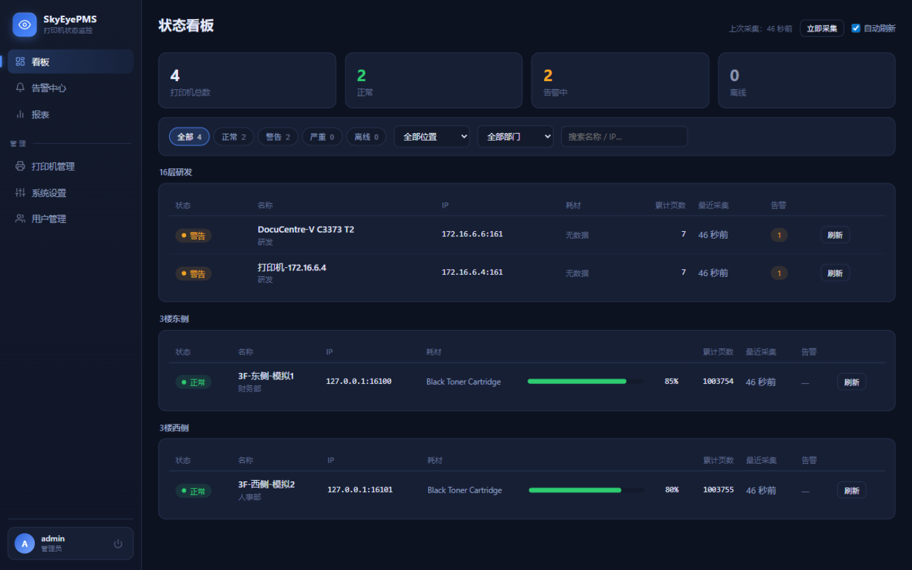
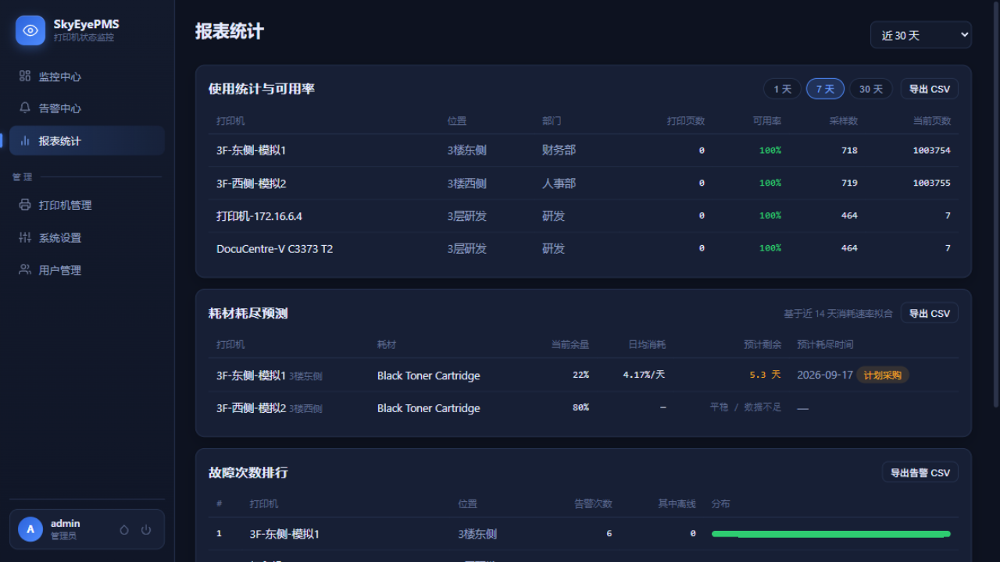
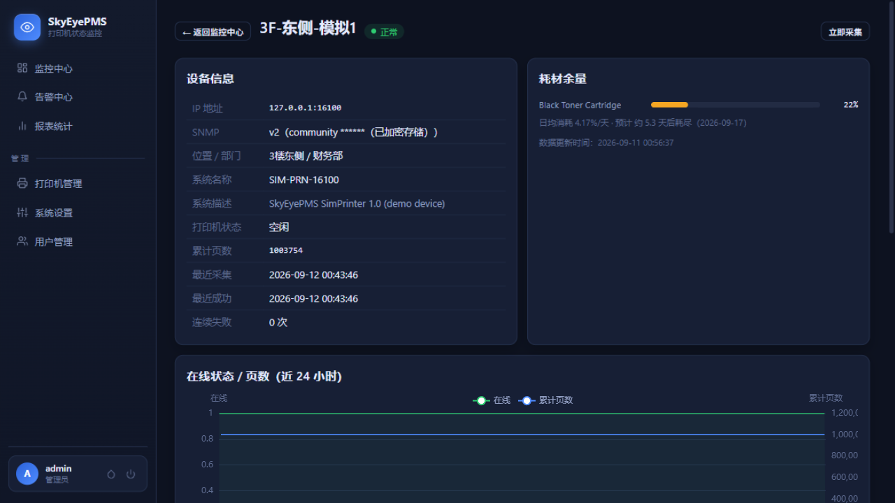

<div align="center">

# SkyEyePMS

**轻量级打印机状态监控系统（Printer Monitoring System）**

通过 SNMP 定时采集网络打印机的状态与耗材信息，集中展示、异常告警。

基于标准 Printer MIB（RFC 3805），多品牌混用环境开箱即用。

| 监控中心（深海蓝） | 报表统计 | 打印机详情（晨雾白） |
|:---:|:---:|:---:|
|  |  |  |

内置 5 套主题皮肤（深海蓝 / 曜石黑 / 极光青 / 暮光紫 / 晨雾白），侧边栏底部一键切换。

</div>

---

## 功能特性

- **打印机注册与分组**：手动添加（IP / SNMP Community 逐台配置 / 位置 / 部门），支持按楼层、部门分组展示；可选网段 SNMP 自动发现
- **定时采集**：异步并发轮询（100+ 台规模友好，可配置间隔 1-5 分钟与并发数），采集：
  - 在线 / 离线状态（hrPrinterStatus、hrDeviceStatus）
  - 硒鼓 / 墨盒余量百分比（prtMarkerSuppliesTable）
  - 纸盒缺纸、卡纸（prtInputTable、hrPrinterDetectedErrorState、prtAlertTable）
  - 累计打印页数（prtMarkerLifeCount）
  - 采集失败自动重试，连续 N 次失败判定离线
- **看板**：状态灯（正常 / 警告 / 严重 / 离线）+ 耗材进度条 + 关键指标，支持状态筛选、位置 / 部门 / 关键字过滤、自动刷新
- **单机详情**：设备信息、耗材余量条、在线状态与页数历史曲线（ECharts）、耗材变化曲线
- **耗材耗尽预测**：基于近 14 天历史采样最小二乘拟合消耗速率，估算日均消耗、预计剩余天数与耗尽日期（详情页展示、报表页汇总、快耗尽标红提醒）
- **使用统计与可用率**：按 1 / 7 / 30 天统计每台打印机打印页数（页数计数器正增量，清零回绕自动跳过）与时段可用率
- **告警**：耗材低于阈值、离线、缺纸、卡纸、设备报告严重错误；连续失败才告警、告警静默期去重、条件解除自动恢复、恢复也推送；支持人工**确认告警**（记录确认人与时间，与自动恢复互不影响）
- **通知渠道（可多选并发 + 分级路由）**：
  | 渠道 | 接入方式 | 消息格式 |
  |---|---|---|
  | 飞书 | 群自定义机器人 Webhook | interactive 卡片（结构化展示），支持签名校验 |
  | 钉钉 | 群自定义机器人 Webhook | Markdown，支持加签 |
  | 企业微信 | 群机器人 Webhook | Markdown |
  | 邮件 | SMTP（企业邮箱 / QQ / 阿里云邮等） | HTML 模板 |
  | 通用 Webhook | POST JSON 到任意地址 | 结构化 JSON（event/severity/printer/message…），对接 ITSM / n8n |
  每个渠道可独立设置**最低推送级别**（全部 / 警告及以上 / 仅严重）与**免打扰时段**（时段内仅推严重告警，支持跨零点）；单渠道失败不影响其它渠道，每次推送留档可查。
- **告警闭环与运维度量**：人工确认告警（记录确认人与时间）、手动恢复、条件解除自动恢复；**平均确认响应时长（MTTA）、确认率、通知成功率**自动统计，运维汇报一键可查
- **SNMP Trap 实时接收**：监听 v1 / v2c Trap（端口可配），收到后立即触发该打印机采集，卡纸 / 缺纸等事件秒级进入告警引擎，不必等下一轮轮询
- **两步验证（TOTP）**：兼容标准验证器 App（RFC 6238），用户自助启用 / 停用，登录采用「密码 + 动态码」两步流程
- **周期报表推送**：按星期 / 时刻把「使用概况 + 耗材预警 + 故障排行 + 待处理告警」周报自动推送到指定渠道
- **部门抄表**：按部门汇总打印页数与可用率，CSV 导出（远程抄表 / 计费 / 成本分摊场景）
- **年度趋势**：日粒度统计任务每日汇总打印量与可用率，原始采样到期清理后长期趋势仍可查（30 / 90 / 365 天切换）
- **资产台账**：序列号采集成功后自动回填（prtGeneralSerialNumber），支持型号 / 资产编号 / 投运日期维护
- **历史与报表**：状态 / 耗材历史保留天数可配置并自动清理；故障次数排行、耗材更换频率统计、使用统计 / 耗尽预测报表，告警与报表均支持 **CSV 导出**（UTF-8 BOM，Excel 直接打开）
- **审计日志**：打印机增删改、告警确认 / 恢复、设置修改、用户管理等操作全量留痕，可按动作过滤
- **集成**：内置 OpenAPI 文档（`/openapi/v1.json`），可导入 Apifox / Postman 或生成客户端代码
- **界面**：深色监控风设计系统，5 套主题皮肤（深海蓝 / 曜石黑 / 极光青 / 暮光紫 / 晨雾白）一键切换并记忆选择，图表配色跟随主题
- **安全**：JWT 登录鉴权、admin / viewer 角色分级、BCrypt 密码哈希、SNMP Community 等敏感字段 AES-GCM 加密存储、登录与全局 API 限流——公网 / 异地部署可用
- **部署**：.NET 10 跨平台（Windows / Linux / Docker），支持单容器（API 直接托管前端）或前后端分离部署

## 技术栈

| 层 | 技术 |
|---|---|
| 后端 | C# / .NET 10（单体：Web API + SNMP 采集 Hosted Service） |
| SNMP | [SharpSnmpLib (#SNMP)](https://www.nuget.org/packages/Lextm.SharpSnmpLib) |
| 数据库 | MySQL 5.7+（默认）或 SQLite（零配置试用） |
| 数据访问 | Dapper |
| 前端 | Vue 3 + Vue Router + ECharts（Vite 构建） |
| 部署 | Windows 服务 / systemd / Docker |

## 快速开始（本地试用，零配置数据库）

```bash
# 1. 启动后端（SQLite 模式）
cd backend/src/SkyEyePMS.Api
dotnet run

# 2. 前端（另开终端；开发模式带热更新与代理）
cd frontend
npm install
npm run dev        # http://localhost:5173

# 3. 用内置模拟器虚拟两台打印机（没有真实 SNMP 打印机也能玩）
cd backend
dotnet run --project tools/SkyEyePMS.SnmpSim -- --ports 16100,16101
```

首次启动会在日志打印随机生成的管理员密码（或通过环境变量 `Seed__AdminPassword` 指定）。登录后在「打印机管理」添加 `127.0.0.1:16100`（community `public`）即可看到采集数据。

## 生产部署（MySQL + 单容器）

### 方式一：Docker Compose（推荐）

```bash
cd docker
# 先按需修改 docker-compose.yml 中的环境变量（数据库密码、JWT 密钥等）
docker compose up -d
# 访问 http://<host>:8080
```

### 方式二：手动部署

```bash
# 构建前端
cd frontend && npm install && npm run build
# 前端产物复制到后端 wwwroot（单进程托管）
mkdir -p backend/src/SkyEyePMS.Api/wwwroot
cp -r frontend/dist/* backend/src/SkyEyePMS.Api/wwwroot/

# 发布后端
cd backend
dotnet publish src/SkyEyePMS.Api -c Release -o publish

# 配置环境变量后运行
export Database__ConnectionString='Server=127.0.0.1;Port=3306;Database=skyeyepms;User ID=skyeye;Password=***;CharSet=utf8mb4;'
export Security__EncryptionKey='一串随机文本-用于加密Community等敏感字段'
export Jwt__SecretKey='32位以上随机文本'
export Seed__AdminPassword='初始管理员密码'
dotnet publish/SkyEyePMS.Api.dll --urls http://0.0.0.0:8080
```

数据库表结构在首次启动时自动创建（迁移脚本内置），无需手工建表。

### 作为 Windows 服务 / systemd 运行

```powershell
sc.exe create SkyEyePMS binPath= "D:\SkyEyePMS\SkyEyePMS.Api.exe" start= auto
```

```ini
# /etc/systemd/system/skyeyepms.service
[Unit]
Description=SkyEyePMS Printer Monitoring
After=network.target mysql.service

[Service]
WorkingDirectory=/opt/skyeyepms
ExecStart=/usr/bin/dotnet /opt/skyeyepms/SkyEyePMS.Api.dll --urls http://0.0.0.0:8080
Environment=Database__ConnectionString=Server=127.0.0.1;Database=skyeyepms;User ID=skyeye;Password=***;
Environment=Security__EncryptionKey=***
Environment=Jwt__SecretKey=***
Restart=always

[Install]
WantedBy=multi-user.target
```

## 配置说明

所有配置可用环境变量覆盖（.NET 标准双下划线约定），敏感项**务必**用环境变量注入，参考 `backend/src/SkyEyePMS.Api/appsettings.example.json`：

| 环境变量 | 说明 |
|---|---|
| `Database__Provider` | `mysql`（默认）或 `sqlite` |
| `Database__ConnectionString` | MySQL 连接串 |
| `Database__SqlitePath` | SQLite 文件路径（sqlite 模式） |
| `Polling__IntervalMinutes` | 轮询间隔（默认 2，建议 1-5） |
| `Polling__Concurrency` | 并发采集台数上限（默认 20，100+ 台建议 20-30） |
| `Polling__Enabled` | `false` 关闭后台轮询（仍可手动触发） |
| `Snmp__TimeoutMs` | 单次 SNMP 请求超时（默认 2500） |
| `Snmp__Retries` | 采集失败重试次数（默认 1） |
| `Security__EncryptionKey` | 敏感字段加密密钥（**必须修改**，更换后旧密文无法解密） |
| `Security__LoginRateLimit` | 登录接口限流：次/分钟/IP（默认 10） |
| `Security__GlobalRateLimit` | 全局 API 限流：次/分钟/IP（默认 600） |
| `Jwt__SecretKey` | JWT 签名密钥（**必须设置 32+ 位**，否则重启后需重新登录） |
| `Jwt__ExpireHours` | Token 有效期（默认 12 小时） |
| `Seed__AdminUsername` / `Seed__AdminPassword` | 首次建库时的管理员账号；密码留空则随机生成并打印到日志 |

通知渠道（飞书 / 钉钉 / 企业微信 / 邮件）可直接在 Web 管理页「系统设置」中启用与配置（Secret / SMTP 密码自动加密入库），也可以在 `Notifiers` 配置节里预置。

## 通知渠道申请指引

- **飞书**：目标群 → 设置 → 群机器人 → 添加「自定义机器人」→ 复制 Webhook 地址；如开启「签名校验」把密钥填到 Secret
- **钉钉**：目标群 → 群设置 → 机器人 → 添加「自定义」机器人；安全设置选「加签」复制 SEC 密钥，或选「自定义关键词」（消息标题包含「告警」「恢复」等词即可）
- **企业微信**：群右键 → 添加群机器人 → 复制 Webhook 地址
- **邮件**：使用 SMTP 账号；QQ 邮箱等个人邮箱需在邮箱设置中开启 SMTP 并生成「授权码」作为密码

## SNMP 前置知识

- 打印机需在管理界面开启 SNMP（多数品牌默认开启，community 通常为 `public`）
- 本项目以 **标准 Printer MIB（RFC 3805）+ Host Resources MIB（RFC 2790）** 为主，多品牌通用；不同批次设备 community 不同时可逐台配置
- 采集的 OID：`hrPrinterStatus`、`hrPrinterDetectedErrorState`、`prtMarkerSuppliesTable`（耗材）、`prtInputTable`（纸盒）、`prtAlertTable`（设备告警）、`prtMarkerLifeCount`（页数）、`sysDescr/sysName`
- 防火墙需放行 UDP 161（管理端 → 打印机方向）
- 个别型号标准 MIB 字段缺失 / 不准属正常现象，界面会显示「未知」；如需更精细数据可针对性适配厂商私有 MIB（预留扩展点）

## 项目结构

```
backend/
  src/
    SkyEyePMS.Core/           领域模型、告警引擎（纯函数）、仓储与通知接口
    SkyEyePMS.Infrastructure/ Dapper 仓储（MySQL/SQLite 双方言）、SNMP 采集、
                              四种通知渠道、AES 加密、轮询 Hosted Service
    SkyEyePMS.Api/            Web API（JWT 鉴权、限流）、前端托管、启动初始化
  tools/
    SkyEyePMS.SnmpSim/        SNMP 模拟打印机（演示/联调用，带 HTTP 状态控制接口）
  tests/
    SkyEyePMS.Tests/          单元 + 集成测试（内置 BER 级 SNMP Agent 模拟器）
frontend/                     Vue 3 前端
docker/                       Dockerfile 与 docker-compose.yml
```

## 开发

```bash
# 后端全量测试（SNMP 模拟、告警状态机、API 集成等 67 个用例）
cd backend && dotnet test

# 前端开发
cd frontend && npm run dev
```

## License

[MIT](LICENSE)
